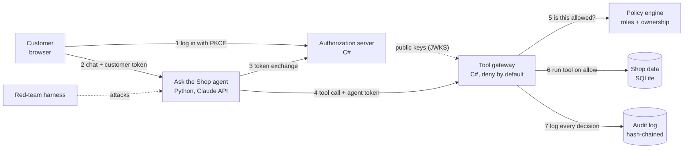

# Architecture

The agent never holds a credential that can do more than the signed-in customer is allowed to do. Authorization is decided by the gateway, outside the model, so a prompt injection can at most cause a denied request.

## One request, step by step

1. The customer logs in with the authorization code flow and PKCE, and receives a 5-minute customer token.
2. The chat message reaches the agent along with that token.
3. The agent exchanges it (RFC 8693) for a 2-minute agent token whose scopes are a subset of the customer's, with an `act` claim naming the agent.
4. The agent calls a tool, presenting only the agent token.
5. The gateway validates the token (signature, issuer, audience, expiry, not-before) and asks the policy engine whether this customer may act on this resource.
6. Only on allow does the tool run against the shop database.
7. Every allow and deny is appended to the audit log, where each record stores the hash of the one before it.

## Standards

| Standard | Used for |
| --- | --- |
| [OAuth 2.1 draft](https://datatracker.ietf.org/doc/draft-ietf-oauth-v2-1/) | Overall flow |
| [RFC 7636](https://datatracker.ietf.org/doc/html/rfc7636) | PKCE |
| [RFC 7519](https://datatracker.ietf.org/doc/html/rfc7519), [RFC 7517](https://datatracker.ietf.org/doc/html/rfc7517) | JWT access tokens and JWKS |
| [RFC 8693](https://datatracker.ietf.org/doc/html/rfc8693) | Token exchange for the agent token |
| [RFC 8707](https://www.rfc-editor.org/rfc/rfc8707.html) | Resource indicators (audience binding) |
| [RFC 9728](https://datatracker.ietf.org/doc/html/rfc9728) | Protected resource metadata |
| [RFC 6750](https://datatracker.ietf.org/doc/html/rfc6750) | Bearer tokens and `WWW-Authenticate` challenges |
| [RFC 9700](https://datatracker.ietf.org/doc/html/rfc9700) | OAuth security best current practice |
